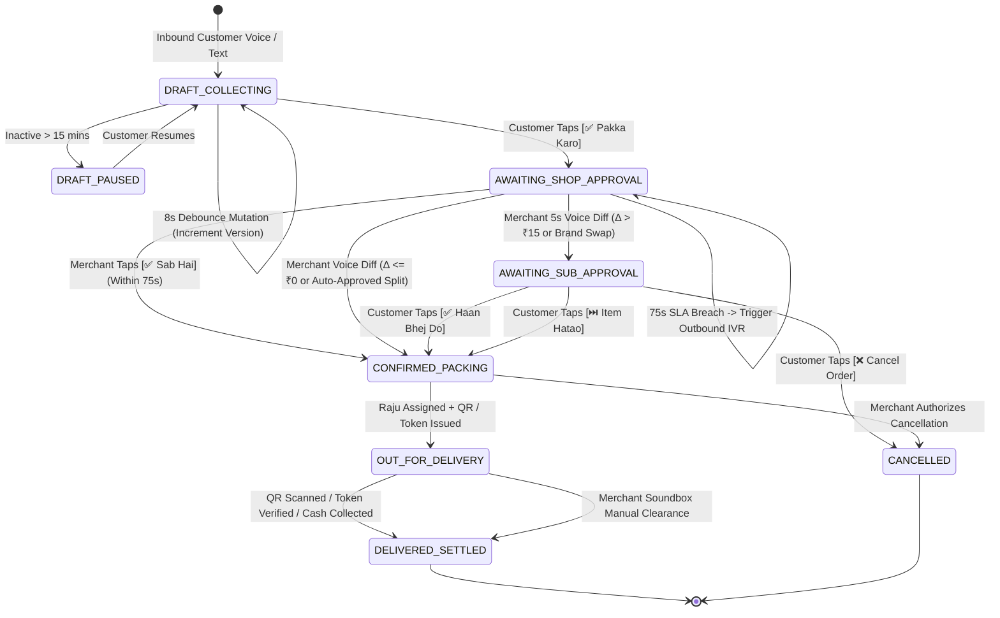

# Application Flow & Execution Pipelines (AppFlow.md)
## Project GallaVaani: User Journeys, State Machine & Failure Register

---

### 1. End-to-End User Journey (Customer, Shopkeeper, Raju)

```
CUSTOMER WHATSAPP (+91-98XXXXXXXX)           GALLAVAANI ENGINE (GNANI AI)            SHOPKEEPER WHATSAPP (RAMESH SETH)
──────────────────────────────────           ────────────────────────────            ─────────────────────────────────
1. Holds Mic & sends 18s Voice Note:
   "Bhaiya 5kg Aashirvaad atta, pao
   bhar hari mirch, 10-wale 4 Maggi,
   aur wahi pichli baar wali chai"
   ─────────────────[OGG/Opus Webhook]──────► • Downloads Media & Denoises
                                              • Gnani Prisma v3.0 (codemix + keyterms)
                                              • Normalizes: "pao"→250g, "10-wale"→MRP10
                                              • Resolves "pichli baar wali chai" →
                                                Tata Tea Agni 250g from History
                                              • Synthesizes 6s Readback (Timbre v3.0)
   ◄────────[Interactive Parchi + 6s Voice]──
   Shows 4 items | Est: ₹465 | Addr: Awas Vikas
   Buttons: [✅ Pakka Karo] [🎙️ Badlo] [💳 Mode]

2. Taps [✅ Pakka Karo (Khata)] ─────────────► • Locks Provisional Order #GV-204
                                              • Starts 75s Shopkeeper SLA Timer
                                              ────────────[Shopkeeper Parchi]───────► 3. Sees Structured Slip #GV-204
                                                                                         Buttons: [✅ All OK - Pack ₹465]
                                                                                         OR Swipe-to-Reply with Voice Note.
                                                                                      
                                                                                      4. Holds Mic (5s Voice Override):
                                                                                         "Aashirvaad 5kg nahi hai, Pillsbury
                                              ◄───────────[5s OGG Voice Note]────────    hai ₹240 ka, aur mirch ₹15 ki"
                                              • Gnani Prisma v3.0 REST (with Cart in
                                                `previous_text`) parses diff:
                                                - Swap Aashirvaad → Pillsbury 5kg (₹240)
                                                - Update Total: ₹450
   ◄────────[Substitution Approval Card]─────
   "Aashirvaad ki jagah Pillsbury 5kg (₹240)
   bhej dein? Naya Bill: ₹450"
   Buttons: [✅ Haan Bhej Do] [❌ Item Hatao]

5. Taps [✅ Haan Bhej Do] ───────────────────► • Order -> CONFIRMED_PACKING
                                              • Generates Cloned Voice Note
                                                (vachana-vc-v1 in Ramesh's voice)
                                              • Sends Raju Dispatch Ticket (Items +
                                                Customer Address Audio + Dynamic QR)
   ◄──[Cloned Voice Note + ETA: 22 mins]─────                                         ◄──[Raju Dispatch Card + QR Generated]
```

---

### 2. Finite State Machine (FSM) & State Transitions



#### Hard Architectural Invariants (Enforced in Database & State Reducer)
- **Invariant 1 (No Unverified Dispatch):** An order cannot transition to `CONFIRMED_PACKING` directly from `DRAFT_COLLECTING`. It must carry an authentic merchant approval event ID (1-tap button tap or transcribed voice override from `shopkeeper_wa_id`).
- **Invariant 2 (No Silent Upcharge):** If revised total exceeds approved total by $>₹15$ or brand substitutions occur, transition to `CONFIRMED_PACKING` without intermediate customer consent in `AWAITING_SUB_APPROVAL` is strictly prohibited.
- **Invariant 3 (Monotonic Cart Version Locking):** Each modification increments `cart_version_id`. Button clicks with `payload_version < current_version` are rejected as stale.
- **Invariant 4 (Idempotent Settlement):** Once in `DELIVERED_SETTLED`, financial state is immutable. Secondary payment webhooks route directly to customer credit (`EXCESS_PAYMENT_KHATA_CREDIT`).
- **Invariant 5 (Forbidden Post-Dispatch Self-Cancellation):** Customer webhooks cannot cancel an order in `OUT_FOR_DELIVERY`. Only `shopkeeper_wa_id` can authorize returns once the helper departs.

---

### 3. Edge-Case and Failure-Handling Register

#### Cluster 1: Customer Sends Unclear Voice Note / Low ASR Confidence / Heavy Dialect
- **Trigger & Signal:** Prisma v3.0 returns empty string, audio duration $<0.8\text{s}$, SNR $<3\text{dB}$, or SKU confidence score $<0.68$.
- **Automated Handling:** Lock clear items into provisional cart. Slices the exact 3-second audio segment $[t_{\text{start}}, t_{\text{end}}]$ of the unclear span using FFmpeg. Prompts one clarification turn.
- **Strike 2 Fallback:** If still $<0.68$, triggers 2-Strike Raw Audio Passthrough. Injects `[🎵 Voice Item #4 (Listen)]` into the cart and forwards cropped clip to merchant WhatsApp slip.
- **Human Escalation:** If $>50\%$ of items fail twice, transmits a 1-tap `[📞 Direct Call Shop]` button.
- **Demo-Safe Behavior:** Pre-seed demo with mumbled item ("ek packet woh local namkeen") to show real-time audio slicing.

#### Cluster 2: Customer Rapid Messages / Mid-Flow Order Modifications
- **Trigger & Signal:** Incoming webhooks from same `wa_id` within 8-second debounce window or during review states.
- **Automated Handling:** Buffers incoming media inside Redis list `inbox:{wa_id}`. Transcribes audio in parallel via Prisma v3.0. Executes unified state-reducer pass to resolve self-corrections ("Atta 5kg... nahi rukna 10kg kar do").
- **Mid-Flow Mutation:** Increments `cart_version_id` ($v1 \rightarrow v2$). Invalidates buttons on previous slip. Transmits updated $v2$ Parchi.
- **Fallbacks:** Outdated button clicks return notice: *"Aapne abhi naya item joda hai—kripya nayi Parchi (v2) par tap karein."*

#### Cluster 3: Customer Unresponsive / Offline / Blocked Bot
- **Trigger & Signal:** Cart in `AWAITING_CUSTOMER_CONFIRM` or `AWAITING_SUB_APPROVAL` for $>180\text{ seconds}$. Meta webhook reports single tick or error `131026`/`131047`.
- **Automated Handling:** At $T+3\text{ mins}$, sends gentle WhatsApp reminder. At $T+15\text{ mins}$, shifts cart to `DRAFT_PAUSED`.
- **Smart Pre-Authorized Substitution:** If price delta $\le ₹15$ and involves pack-size split of identical brand (e.g., five 1kg packs for one 5kg bag), auto-approves after 120 seconds. If different brand or $>₹15$, holds disputed item and packs remainder.
- **Fallbacks:** Sends plain transactional SMS summary if single-tick delivery persists $>90\text{ seconds}$.

#### Cluster 4: Shopkeeper Unresponsive / Noisy Counter / Unquoted Override
- **Trigger & Signal:** Order remains in `AWAITING_SHOP_APPROVAL` for $>75\text{ seconds}$, or voice note arrives without quote context (`context.id == null`) during concurrent open orders.
- **Automated Handling:** At $T+75\text{s}$, fires Galla Wake-Up Escalation: automated 10-second outbound IVR ring / soundbox chime.
- **Unquoted Voice Diff Disambiguation:** Entity matcher evaluates which open order contains the spoken item. If unique to Order #204, auto-binds to #204. If ambiguous, displays 1-tap selector buttons: `[Order #204 - Sunita] [Order #205 - Verma]`.

#### Cluster 5: Out of Stock / Price Escalation / Order Cancellation
- **Trigger & Signal:** Shopkeeper voice note contains negation or replacement keywords ("nahi hai", "khatam", "bhejoon kya", "rate badh gaya") or customer taps `[❌ Cancel]`.
- **Automated Handling:** Caches out-of-stock items in the 24-Hour Ephemeral Out-of-Stock Cache (`ephemeral_oos:{merchant_id}`) with midnight TTL. Future customer orders for that SKU warn the customer upfront during intake.
- **Delta Thresholds:** Price decrease or identical pack split auto-confirms. Brand replacement or price increase $>₹15$ moves to `AWAITING_SUB_APPROVAL`.
- **Cancellation Guard:** Free cancellation permitted prior to `OUT_FOR_DELIVERY`.

#### Cluster 6: Duplicate Order / Duplicate Payment / Khata Spoofing
- **Trigger & Signal:** Inbound basket with $>80\%$ Jaccard similarity within 30 minutes, or conflicting payment status.
- **Automated Handling:** Evaluates idempotency key `hash(wa_id + normalized_items + 15_min_bucket)`. Intercepts repeat orders with confirmation notice before alerting shopkeeper.
- **Payment Deduplication:** Duplicate UPI payments automatically credit customer's digital Bahi-Khata ledger (`+₹365 credit`).
- **Anti-Spoof Lock:** Charging orders to Khata mode from an unverified phone number or to an unknown address is blocked without 2-word handover code verification.

#### Cluster 7: Address Ambiguity / GPS Drift / Helper Lost
- **Trigger & Signal:** GPS pin $>3\text{ km}$ outside store perimeter, or conflicts with spoken landmark.
- **Automated Handling:** Spoken landmark audio takes precedence over cellular cell-tower GPS drift. Raju's ticket flags: *"⚠️ Map Pin Galat Ho Sakta Hai — Audio Landmark Sunein"*.
- **Helper Lost:** Raju taps `[⚠️ Ghar Nahi Mila]`. Engine triggers priority WhatsApp alert and outbound ring to customer, providing masked calling link.

#### Cluster 8: WhatsApp API Outage / Media Download Failure / Webhook Latency
- **Trigger & Signal:** Meta returns error `132001` (Template paused/rejected), `131053` (Media download failure), or HTTP 5xx.
- **Automated Handling:** Hot-swaps to secondary pre-approved Utility Template (`_backup_v2`). Falls back to free-form interactive messages if within 24h CSW. Executes 3 exponential backoff retries (200ms, 600ms, 1500ms) for media retrieval.
- **Merchant Outage Fallback:** Routes counter slip via transactional SMS + automated voice call if WhatsApp API fails $>10\text{ seconds}$.

#### Cluster 9: Gnani STT/TTS Latency Spike / Voice Cloning Degradation
- **Trigger & Signal:** Prisma v3.0 REST call exceeds 3,500ms timeout; Timbre v3.0 exceeds 2,500ms timeout.
- **Automated Handling:** Decouples visual card from voice note! Transmits interactive WhatsApp card at $T=0$. Delivers Timbre voice note asynchronously upon synthesis completion.
- **Cloning Consent Failure:** If merchant embedding check fails or background noise is severe, defaults cleanly to Timbre v3.0 standard profiles (`Avinash` / `Shivani`).

#### Cluster 10: Demo Environment Failure (Venue Wi-Fi Congestion / Sandbox Drop)
- **Trigger & Signal:** Cellular dead zone, Meta webhook delay $>3\text{ seconds}$, or payment sandbox freeze.
- **Automated Handling:** Presenter switches to 1-Click Deterministic Local Webhook Injector on the Judge Console. Injects pre-recorded `.ogg` voice notes directly into FastAPI. Live Gnani Prisma and Timbre endpoints process the request in real time on stage. In complete blackout, flips to Offline Golden Cache.
