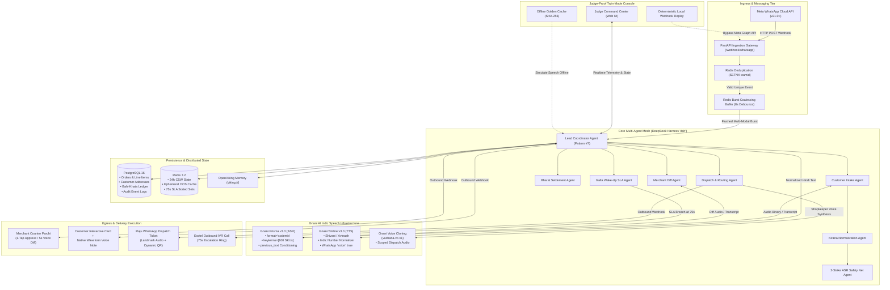

# System Architecture (Architecture.md)
## Project GallaVaani: Multi-Agent Mesh, Topology & Distributed Contracts

---

### 1. Multi-Agent Mesh Topology (Antonio Gulli's Patterns via DeepSeek Harness `dsh`)

GallaVaani constructs its distributed coordination architecture on the **DeepSeek Harness (`dsh`)** multi-agent engine, implementing four verified patterns from Antonio Gulli's *66 Agentic Design Patterns*:
1. **Lead Coordinator (Pattern #7):** Central orchestrator managing order lifecycle, state validation, and inter-agent synchronization.
2. **Dynamic Model Router (Pattern #2):** Routes incoming audio payloads between Gnani Prisma v3.0 REST, low-latency WSS streams, or local fallback SLMs based on network latency and utterance length.
3. **Parallel Subagents (Pattern #3):** Executes simultaneous Indic text normalization, dynamic UPI QR image generation, and ETA route calculations.
4. **Reflection & Self-Correction (Pattern #4):** Evaluates transcribed item lists against previous customer order history and colloquial kirana dictionaries to resolve conversational self-corrections.



---

### 2. Distributed Subagent Mesh Definitions

#### 2.1 Customer Intake Agent (`CustomerIntakeAgent`)
- **Responsibility:** Ingests incoming multi-modal messages (voice note, text follow-up, photo chit).
- **Execution:** Holds the 8-second adaptive debounce window. When silent for 8 seconds, retrieves ephemeral audio files from Meta Graph API and delivers the combined payload to Gnani Prisma v3.0.
- **Output:** Unified chronological text stream.

#### 2.2 Kirana Normalization Agent (`KiranaNormalizationAgent`)
- **Responsibility:** Maps unstructured spoken Indic terms into formal catalog SKUs.
- **Execution:** Employs regex normalizers and LLM slot extraction to convert fractional Hindi weights ("pao", "sawa kilo", "dhai sau gram") into SI units (0.25 kg, 1.25 kg, 250 g). Identifies price-point packs ("10-wali Maggi") and resolves conversational past-order references ("wahi pichli baar wali chai" $\rightarrow$ Tata Tea Agni 250g) using `viking://customer/{wa_id}/history`.

#### 2.3 2-Strike ASR Safety Net Agent (`ASRSafetyNetAgent`)
- **Responsibility:** Guarantees zero order drops due to dialect or hyper-local brand recognition failure.
- **Execution:** Tracks confidence scores per extracted SKU item span. If an item score falls below 0.68, requests a single targeted clarification. If still below 0.68 on the second attempt, slices the exact 3-second audio segment using FFmpeg and attaches it to the cart as `VOICE_PASSTHROUGH_SKU`.
- **Output:** Shopkeeper receives playable audio segment to quote price manually.

#### 2.4 Merchant Diff Agent (`MerchantDiffAgent`)
- **Responsibility:** Translates the shopkeeper's 5-second voice override into an invoice delta.
- **Execution:** Passes active cart items into Prisma v3.0's `previous_text` parameter. Computes differences between current cart and shopkeeper utterance. If price increase exceeds ₹15 or brand changes, shifts order state to `AWAITING_SUB_APPROVAL`. Updates the 24-Hour Ephemeral Out-of-Stock Cache in Redis for omitted items.

#### 2.5 Bharat Settlement Agent (`BharatSettlementAgent`)
- **Responsibility:** Coordinates the four payment rails.
- **Execution:** Evaluates customer credit ceiling against `khata_ledger`, issues signed NPCI dynamic QR codes, formats COD change advisories, and generates 2-word handover tokens. Reconciles payment gateway webhooks.

#### 2.6 Dispatch & Routing Agent (`DispatchRoutingAgent`)
- **Responsibility:** Calculates queue-aware delivery ETAs and batches neighborhood orders.
- **Execution:** Computes $T_{\text{pack}}(N) + T_{\text{zone}}(\text{Mohalla}) + T_{\text{queue}}$. Groups orders within the same mohalla ring placed within 12 minutes. Formats Raju's dispatch card with customer landmark audio and Google Maps pin.

#### 2.7 Galla Wake-Up SLA Agent (`GallaWakeUpAgent`)
- **Responsibility:** Prevents notification blindness at physical counters.
- **Execution:** Sets an expiration timer in Redis (`ZADD sla_timers {now + 75} {order_id}`). If order status does not transition to `CONFIRMED_PACKING` within 75 seconds, triggers an automated outbound IVR ring / soundbox chime.

---

### 3. Inter-Process Communication & Webhook Contracts

#### 3.1 Webhook Delivery Pipeline
```
[Meta Cloud Webhook] ──► [FastAPI Gateway] ──► [Redis Stream] ──► [DeepSeek Harness Worker]
```
- **Payload Schema:** Adheres to Meta Cloud API v21.0 specification.
- **Idempotency Invariant:** Webhook payloads carrying duplicate `entry[0].changes[0].value.messages[0].id` are discarded instantly via Redis `SETNX`.
- **Media Ingestion:** Worker retrieves temporary download link, pulls raw `.ogg` binary, and passes pointer to Prisma client.

#### 3.2 Redis State Channels & Event Bus
- `inbox:{wa_id}`: Sorted list buffering burst messages during the 8-second window.
- `cart:{order_id}`: Hash storing active order state, line items, and version number.
- `ephemeral_oos:{merchant_id}`: Set storing daily out-of-stock SKU tokens with midnight TTL.
- `stream:outbound_messages`: FIFO queue consumed by outbound WhatsApp rate-limiter worker.

---

### 4. Judge-Proof Twin-Mode Mirror Console Architecture

To prevent live hackathon stage failures caused by conference Wi-Fi congestion or Meta API throttling, GallaVaani integrates a dual-transport presentation console:

```
                               ┌───────────────────────────┐
                               │   JUDGE COMMAND CENTER    │
                               │  (Split-Screen Dashboard) │
                               └─────────────┬─────────────┘
                                             │
                       ┌─────────────────────┴─────────────────────┐
                       ▼                                           ▼
          [Live WhatsApp Mode]                       [Twin-Mode Injector]
       Real smartphones & 4G/Wi-Fi               1-Click Deterministic Replay
       Direct Meta Cloud API v21.0+               Bypasses Meta Cloud API
       Synchronous Webhook Flow                   Direct Local Webhook Injection
                       │                                           │
                       └─────────────────────┬─────────────────────┘
                                             ▼
                             ┌───────────────────────────────┐
                             │    Local FastAPI Gateway      │
                             │ (Live Gnani Prisma & Timbre)  │
                             └───────────────┬───────────────┘
                                             │ (Fallback on Venue Blackout)
                                             ▼
                             ┌───────────────────────────────┐
                             │  Offline Golden Cache (SHA256)│
                             │ Pre-computed Speech Responses │
                             └───────────────────────────────┘
```

1. **Mode 1 (Live WhatsApp):** Live connection between smartphones, Meta Graph API, and cloud backend.
2. **Mode 2 (Local Webhook Injector):** Presenter clicks `[⚡ Fire Pre-Recorded WhatsApp Payload]`. Injects authentic noisy Indian `.ogg` voice notes directly into `/webhook/whatsapp`. Executes live Gnani Prisma v3.0 transcription, cart diffing, and Timbre v3.0 synthesis in real time on stage.
3. **Mode 3 (Offline Golden Cache):** In total internet blackout, serves pre-cached SHA-256 matched Gnani speech JSON and `.ogg` waveforms locally with realistic simulated latency (350ms).
